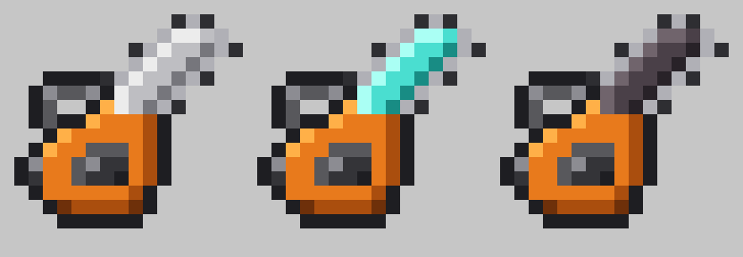

# The Local Chainsaws

Forge 1.20.1 mod (47.x) for The Local's server: iron, diamond and netherite chainsaws that fell whole trees.
Our own clean-room code, art and sound, MIT licensed.

## Gameplay

- **Break any log of a natural tree with a chainsaw (standing, not crouching)**: the whole tree comes down. Every log
  drops as an item through its normal loot table with the chainsaw as the tool (Fortune, Silk Touch and loot modifiers
  apply); the leaves that would now decay are broken with their decay loot (saplings, sticks, apples); everything lands
  at the stump; a sapling is replanted (four for a 2x2 trunk when four dropped), and for 3 seconds a still-swinging
  chainsaw can't knock the new sapling out again.
- Caps per felling: iron 64 logs, diamond 128, netherite 256 (nearest first, so a bigger tree is cut from the bottom up).
- 1 durability per log; it stops with 1 durability left instead of breaking.
- Only natural trees: the logs must touch at least 4 natural (non-persistent) leaves, and only logs of the same kind
  above the cut, within 12 blocks sideways, are taken. Player-placed leaves are persistent, so builds are safe.
- Chainsaws are real `AxeItem`s (vanilla axe damage/speed for the tier): they mine wood fast, strip logs and take axe
  enchantments. Netherite is fire resistant.
- **Crouching (sneaking)** is left to [Tree Harvester](https://modrinth.com/mod/tree-harvester) (server-only on The Local): it fells
  trees for any axe while crouching, and chainsaws count as axes, so its `axeWhitelist` does not need them. Both mods test
  the same thing (`Player.isCrouching()`), so exactly one of them acts on a break; the self-test checks this with Tree
  Harvester installed. Without Tree Harvester, crouching chops a single log. (If Tree Harvester's `treeHarvestWithoutSneak`
  were ever turned on, whichever runs first takes the tree and the other finds nothing left to fell.)
- Nether stems (no leaves) are not felled by the chainsaw itself; sneak for Tree Harvester's nether-tree support.

## Fighting

- **Swing** (left-click): a normal axe hit (same damage, cooldown, shield-disabling and 2 durability as the vanilla axe
  of the tier) plus a rev burst sound and sparks and blood where the chain meets the mob. Skeletons, golems, slimes,
  blazes and the like get extra sparks instead of blood (`data/localchainsaws/tags/entity_types/bloodless.json`).
- **Hold right-click** (anywhere: in the air, at a mob, at the ground) to start the engine: a rev-up sound and a puff
  of smoke, and 12 ticks (0.6 s) of wind-up while the saw is brought up. Once it's revved up, as long as right-click is
  held, the chain saws **what's right in front of you** every 5 ticks (4 times a second): up to 3 living things
  (the one under the crosshair first, then the nearest) whose hitbox is within 2 blocks (shorter than a normal hit's 3)
  inside a narrow 45° cone around where you look, not behind a block. These numbers (wind-up, interval, damage factor,
  reach, cone, max targets) are the tuning constants at the top of `ChainsawCombat`.
  Letting go winds the engine down (rev-down sound, a little smoke); press again for a new wind-up.
  - Each thing sawn takes 1.1x the damage per second of perfectly timed axe swings (axe damage incl.
    Sharpness/Smite/Strength x attack speed), so iron ~8.9, diamond ~9.9, netherite ~11 per second against no armour,
    and costs 1 durability. The saw stops by itself with 1 durability left, even in the middle of a sweep (it never
    breaks from revving), and won't start again until it's repaired.
  - Never sawn: you, what you're riding (and anyone riding with you), teammates, your own pets, armor stands.
    Someone else's tamed pet only when it's under your crosshair. Players are sawn like mobs where PvP is on.
  - Bites don't knock the target back (it stays in the chain), use up the swing cooldown (rev-then-swing is no faster),
    respect the usual attack checks (PvP setting, claim/protection mods via `AttackEntityEvent`, shields block them),
    and kills read "X was shredded by Y" (damage type `localchainsaws:chainsaw`).
  - Right-click still does what the block does first: a log is stripped (no rev), a chest opens; anything without a
    right-click use of its own (stone, grass, air) revs. Revving never breaks blocks. With a **shield in the off hand**
    right-click keeps blocking. Left-click felling and the crouch / Tree Harvester split are unchanged. You walk slowly
    while revving, like drawing a bow.
  - Sound: the rev-up and rev-down are sent to everyone nearby (and played at once on your own client); every client
    plays a seamless engine loop for each player it sees revved up (the "using an item" flag is synced vanilla entity
    data), fading in as the rev-up tops out, and the first-person chainsaw rises during the wind-up and shakes once
    revved. Smoke, sparks/blood and the swing per sweep are sent by the server to everyone nearby. Particles follow
    the client's particle setting.

## Recipes

- Iron Chainsaw: `" I "`, `" RS"`, `" S "` (I iron ingot, R redstone, S string)
- Diamond Chainsaw: `" DR"`, `"RSR"`, `" S "` (D diamond)
- Netherite Chainsaw: smithing table, netherite upgrade template + diamond chainsaw + netherite ingot (like vanilla
  netherite tools; keeps enchantments).

## Build

```sh
export JAVA_HOME=~/opt/jdk-17.0.20.1+1     # any JDK 17
./gradlew build                            # -> build/libs/localchainsaws-1.20.1-<version>.jar
./gradlew runGameTestServer                # 20 server-side tests: grow trees, cut them with a fake player, count drops;
                                           # swing / rev damage, wind-up, cone sweep and its 2-block / 45° /
                                           # 3-target limits, durability floor, rev vs. felling, log stripping and blocks
```



Art and sound are generated, not drawn by hand in an editor: `tools/make_textures.py [preview.png]` (16x16 sprites,
8x8 spark/blood particles), `tools/make_sound.py` (synthesized two-stroke engine + chain noise, Ogg Vorbis via ffmpeg:
the felling roar, the hit burst, the rev-up, the rev-down and the seamless 2 s rev loop), `tools/make_arena.py` (the empty gametest structure).

`-Dlocalchainsaws.clientcheck=true` on a client logs `[localchainsaws-clientcheck]` lines for every chainsaw sound it
plays, each rev loop it starts (this player / another player) and when it becomes audible, and the spark/blood
particles it spawns per second; the
headless two-client test uses it.

The tests can also run inside a full modpack server: start it with
`-Dlocalchainsaws.selftest=true` (Forge itself only registers gametests in a dev workspace, so this runs the same scenarios through `SelfTest`: trees in the sky around x=30000 z=30000, fake players, a `[localchainsaws-selftest] SUMMARY n/n passed` log line, then it stops the server; throwaway copies only)
With Tree Harvester present the sneaking test expects Tree
Harvester to fell the tree exactly once.
